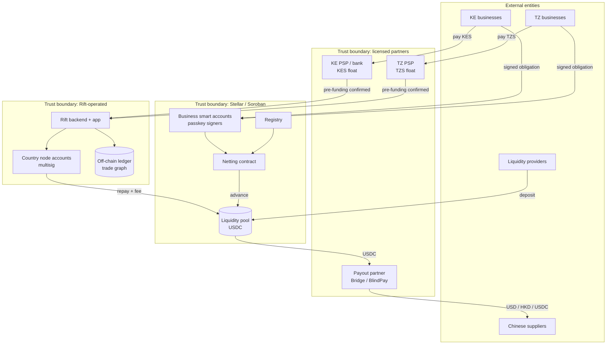
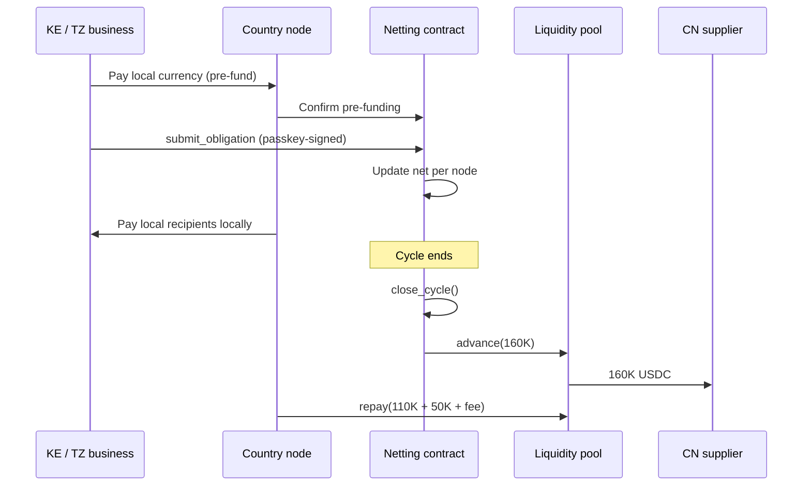
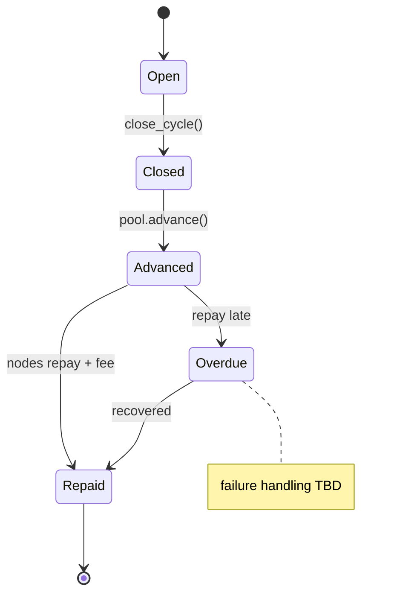
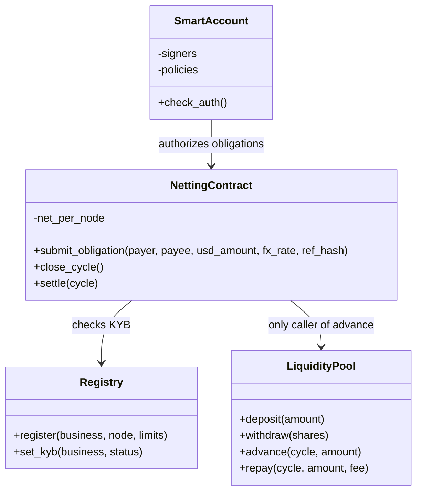
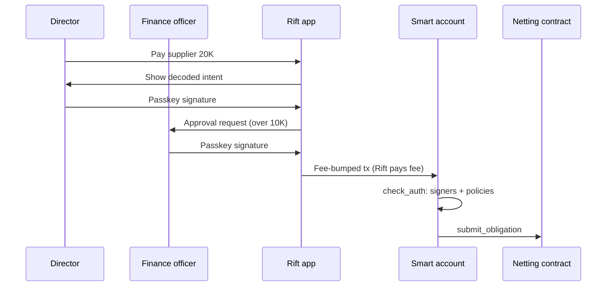
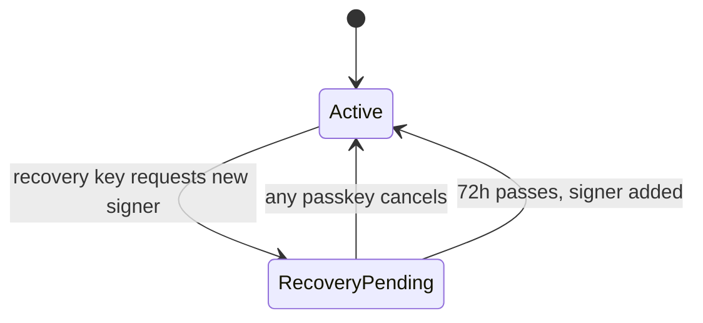

# Rift on Stellar: Netting and Smart Accounts

## 1. Summary

- Businesses pay and get paid in local currency.
- Rift nets obligations every cycle.
- Only the residual moves, as USDC on Stellar.
- Graph: Kenya ↔ Tanzania, plus Chinese suppliers.
- Business funds sit in passkey smart accounts. Rift holds no signing key.

## 2. Architecture

Component diagram. Subgraphs are trust boundaries, as the Stellar threat-model guide requires.

## 3. Participants

| Participant | Role | Stellar account |
| --- | --- | --- |
| KE / TZ businesses | Pre-fund locally, sign obligations | Passkey smart account |
| Chinese suppliers | Get paid | Smart account or payout partner |
| Country nodes | Hold local float, repay pool | Classic multisig |
| Liquidity providers | Fund the residual | Any Stellar wallet |

## 4. Netting cycle

### Example (illustrative)

| Payer | Payee | USD |
| --- | --- | --- |
| KE importers | TZ suppliers | 250,000 |
| TZ importers | KE suppliers | 240,000 |
| KE importers | CN suppliers | 100,000 |
| TZ importers | CN suppliers | 60,000 |
| **Total** | | **650,000** |

| Result | USD |
| --- | --- |
| Trade settled | 650,000 |
| KE ↔ TZ net | 10,000 |
| Dollars needed | 160,000 (= China imports) |

### Sequence

### Cycle states

## 5. Soroban contracts

Rules:

- Running net per node, so `close_cycle()` is constant cost.
- Settlement is one atomic transaction.
- Pool caps per node and per cycle.

## 6. Smart accounts

| Policy | Value (placeholder) |
| --- | --- |
| Signers | Director, finance officer, recovery key |
| Under $10K | 1 signer |
| Over $10K | 2 signers (maker-checker) |
| Daily limit | $50K |
| Allowlist | Netting contract, approved suppliers |

### Signing

### Recovery

### Wallet OS vs Stellar

| | Wallet OS (EVM) | Stellar smart account |
| --- | --- | --- |
| Verifies consent | Rift enclave | Stellar network |
| Rift signing key | Yes, in enclave | None |
| Re-pin gap | Yes | No |
| Fees | Paymaster | Fee-bump, CAP-33 sponsorship |

## 7. Integrations

| Need | Integration List item | Time |
| --- | --- | --- |
| Liquidity from Base | CCTP | 1–5 days |
| Pay Chinese suppliers | Bridge or BlindPay | 1–5 days / 1–2 weeks |
| KES/TZS anchor (SEP-31) | Anchor Platform | 1+ month |
| Wallets | Stellar Wallets Kit | < 1 day |

Local ramps: Pretium, Paycrest, SasaPay, TEMBO.

## 8. Open decisions

| Topic | Recommendation |
| --- | --- |
| Privacy | Pseudonymous IDs + invoice hash on-chain; graph off-chain |
| Cycle length | Daily |
| China leg | Payout only for now |
| Licensing | Partner PSPs + bank; confirm before 4 Nov 2026 |
| Pool risk | Caps + stress buffer |
| Failures | Design next |

## 9. SCF fit (Integration Track)

| Requirement | How |
| --- | --- |
| Stellar is core | USDC settles on Stellar every cycle |
| Open source | All contracts public |
| Integration List | CCTP, Bridge/BlindPay, Anchor Platform, Wallets Kit |
| Tranche 2 threat model | Diagram in section 2 + STRIDE |
| Final-tranche metric | Cumulative USDC through registered contracts |
| Traction | $600K on Base, wallet addresses + Dune |
| Content rules | No "yield", "returns", "earn" |
