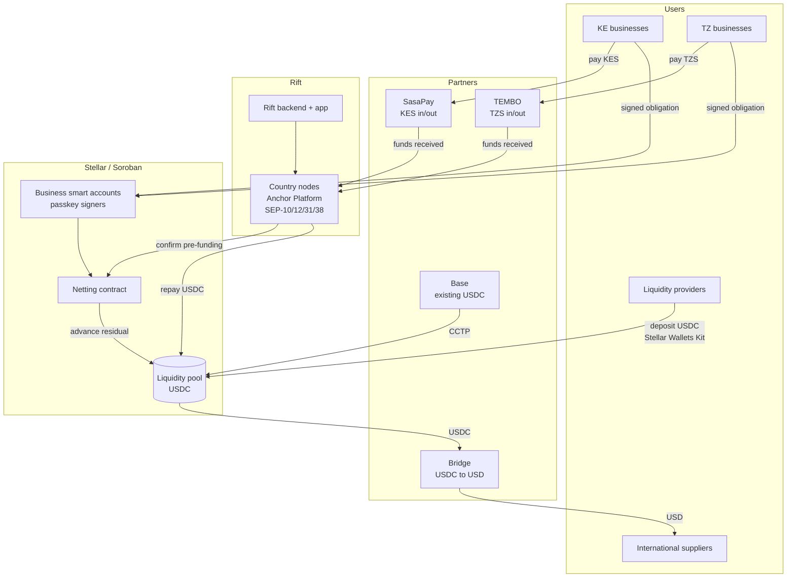
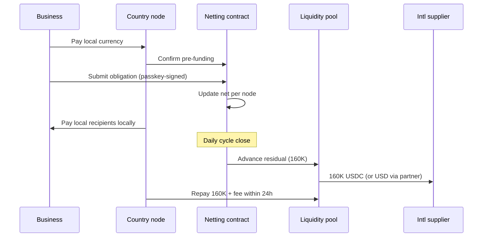
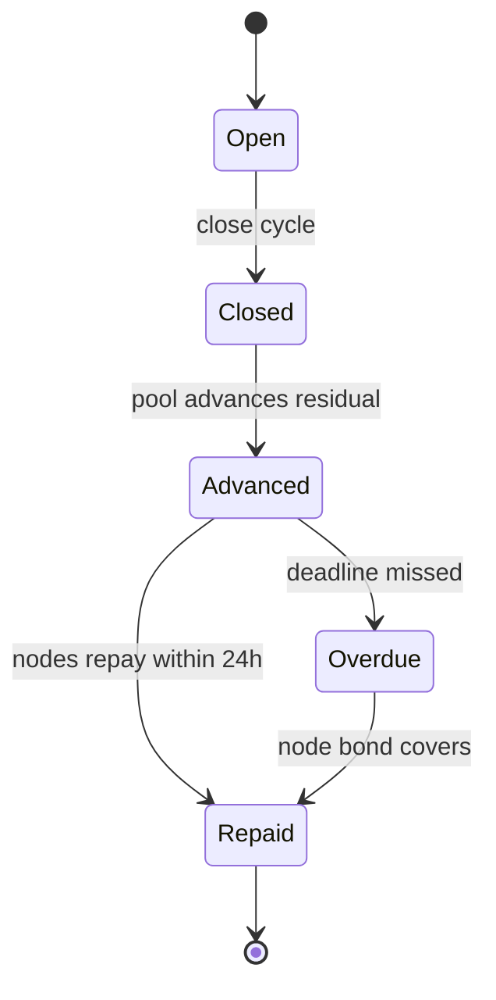
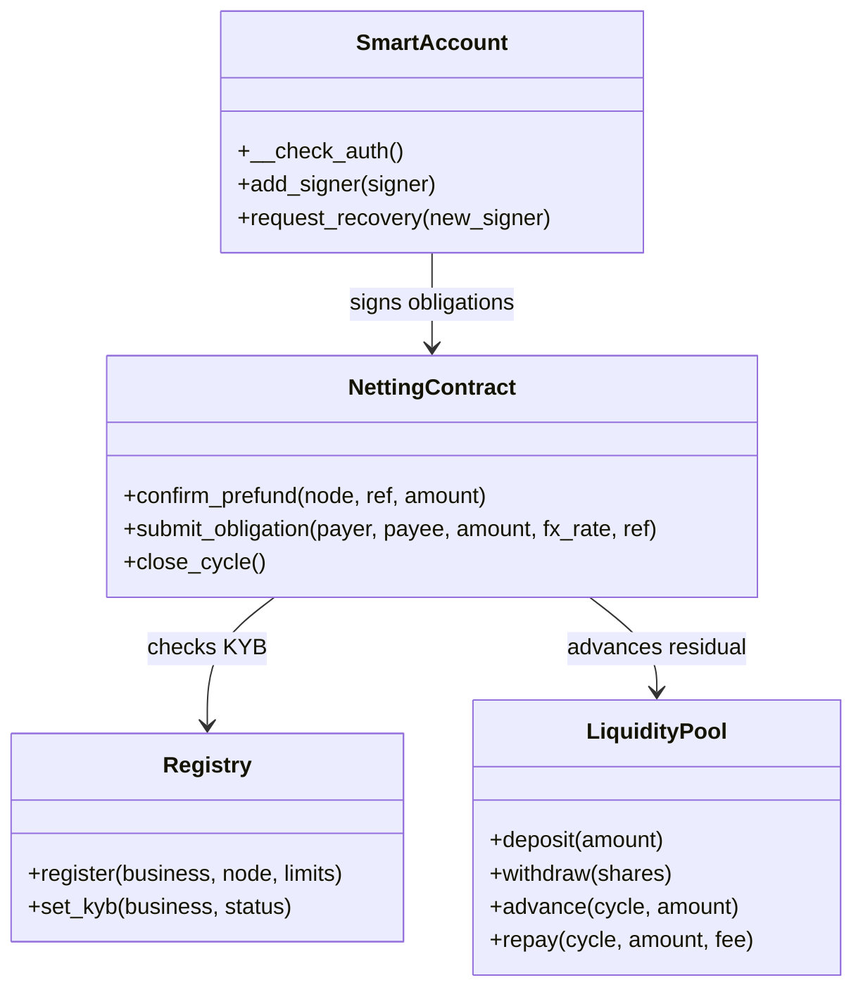
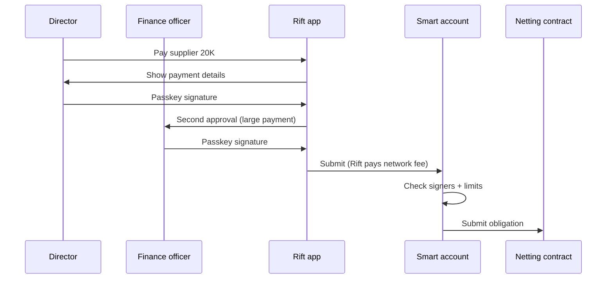
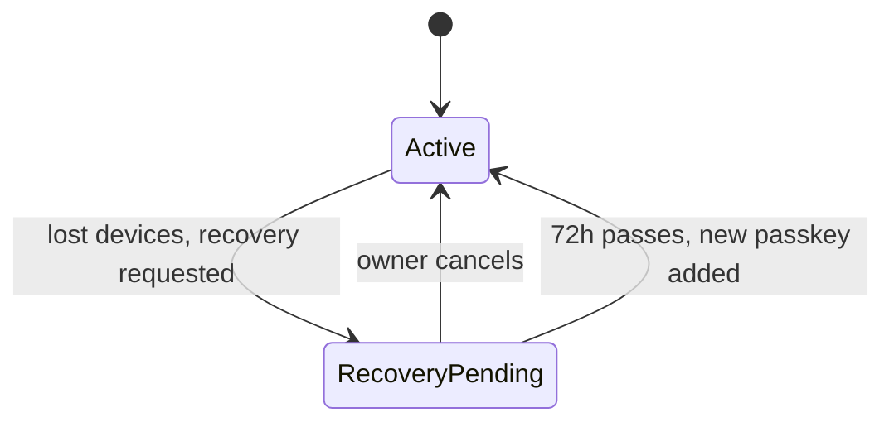

# Rift on Stellar: How It Works

## 1. Overview

- Businesses pay and get paid in local currency.
- Rift nets their obligations once a day.
- Only the residual moves, as USDC on Stellar.
- Corridor: Kenya ↔ Tanzania, plus international suppliers.
- International suppliers = suppliers outside East Africa. We start with China, where most of our businesses' suppliers are.
- Businesses hold passkey smart accounts. Rift holds no key that can move their funds.

## 2. Architecture

## 3. Participants

| Participant | Role |
| --- | --- |
| KE / TZ businesses | Pay in local currency, sign obligations |
| International suppliers | Receive USD or USDC |
| Country nodes | Hold local currency, pay local recipients, repay the pool |
| Liquidity providers | Fund the residual in USDC |

## 4. One cycle

### Example

| Payer | Payee | USD |
| --- | --- | --- |
| KE importers | TZ suppliers | 250,000 |
| TZ importers | KE suppliers | 240,000 |
| KE importers | Intl suppliers | 100,000 |
| TZ importers | Intl suppliers | 60,000 |
| **Total** | | **650,000** |

| Result | USD |
| --- | --- |
| Trade settled | 650,000 |
| KE ↔ TZ after netting | 10,000 |
| Dollars needed | 160,000 (= international imports) |

### Steps

### Cycle states

## 5. Soroban contracts

- Only KYB-verified businesses can submit obligations.
- Obligations need confirmed pre-funding first.
- The pool only advances to the netting contract.
- All contracts are open source.

## 6. Smart accounts

Each business account is a Soroban contract. Its signers are the business's own passkeys, verified on-chain.

### Signing

### Recovery

## 7. Stellar stack

| Stellar component | How Rift uses it |
| --- | --- |
| USDC on Stellar | Settlement asset; moved through its Stellar Asset Contract (SAC) `transfer` |
| Soroban (Rust, soroban-sdk) | Registry, netting contract, liquidity pool, smart accounts |
| secp256r1 verification (CAP-51) | Passkey signatures checked on-chain in `__check_auth` |
| Fee-bump transactions (CAP-15) | Rift pays network fees for business transactions |
| Sponsored reserves (CAP-33) | Rift sponsors reserves for business accounts |
| Stellar RPC | Transaction submission, simulation, contract events |
| Contract events | Monitoring: obligation, cycle close, advance, repay, overdue |

## 8. Integration plan: building blocks

Four building blocks from the SCF Integration List.

### 8.1 CCTP: Base → Stellar USDC

- **What:** move Rift's existing USDC liquidity from Base to Stellar.
- **How:** burn USDC on Base with CCTP `depositForBurn` (Stellar as destination). Mint native USDC on Stellar to the liquidity pool or a node account.
- **Where:** funding the pool; moving existing Base business balances to Stellar.
- **Done when:** a Base → Stellar transfer lands in the pool on testnet, then mainnet.

### 8.2 Bridge: pay international suppliers

- **What:** turn USDC on Stellar into USD in the supplier's bank account.
- **How:** register each supplier as a Bridge customer with an external bank account. Bridge gives a Stellar deposit address per supplier. The pool sends USDC to that address. Bridge pays out USD.
- **Where:** step "pool → international supplier" in the cycle.
- **Status back:** Bridge webhook confirms payout. A failed payout returns USDC to the pool and is retried next cycle.
- **Done when:** end-to-end USDC → USD payout to a supplier on mainnet.

### 8.3 Anchor Platform: KE and TZ nodes

- **What:** each country node runs the Stellar Anchor Platform.
- **How:**
    - SEP-1: `stellar.toml` publishes node info.
    - SEP-10: businesses and partner anchors authenticate with Stellar accounts.
    - SEP-12: KYB data for each business.
    - SEP-38: firm quotes. This is the FX rate locked at submission.
    - SEP-31: receive cross-border payments and pay out KES/TZS through SasaPay and TEMBO.
- **Where:** pre-funding confirmation, local payouts, and inbound payments from any Stellar wallet or anchor.
- **Done when:** a SEP-31 payment from a test sender pays out KES and TZS.

### 8.4 Stellar Wallets Kit: liquidity providers

- **What:** liquidity providers connect any Stellar wallet (Freighter, LOBSTR, xBull and others).
- **How:** the Rift LP dashboard uses Stellar Wallets Kit to sign `deposit` and `withdraw` calls to the pool contract.
- **Done when:** an LP deposits and withdraws USDC from the pool on mainnet.

## 9. Milestones

| Tranche | Deliverable | How reviewers verify |
| --- | --- | --- |
| 1. MVP | Netting contract, pool and smart accounts on testnet; CCTP testnet transfer; Stellar Wallets Kit deposit | Testnet contract IDs, transaction hashes, demo video |
| 2. Testnet | Anchor Platform (SEP-10/12/31/38) for KE and TZ; Bridge sandbox payouts; full cycle on testnet; threat model and monitoring plan | Repo, testnet cycle transactions, threat model doc |
| 3. Mainnet | Contracts on mainnet; live KE ↔ TZ cycles; Bridge live payouts | Mainnet contract IDs; on-chain metric below |

**Final-tranche metric:** $500K cumulative USDC settled through Rift's registered netting and pool contracts within 60 days of mainnet launch.
