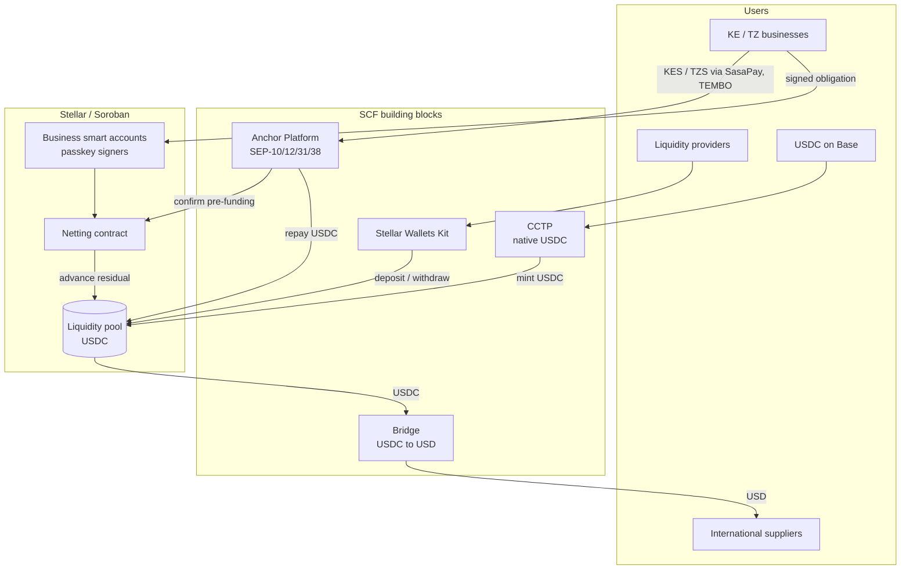
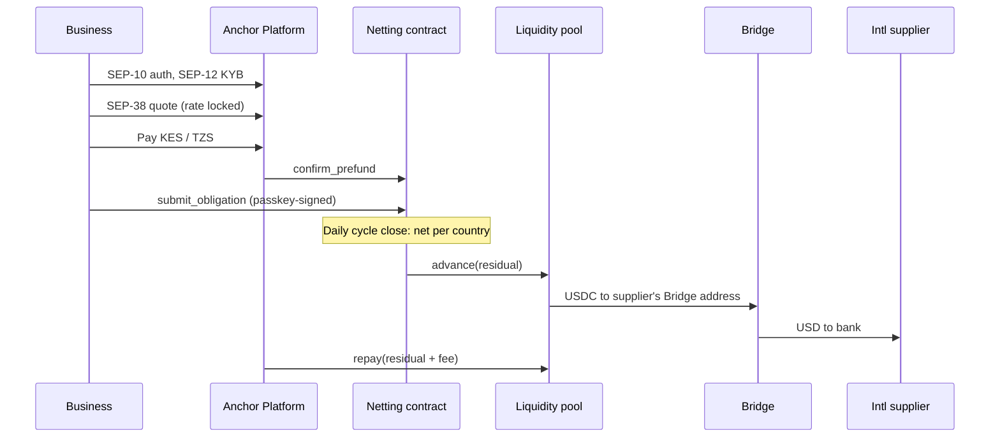
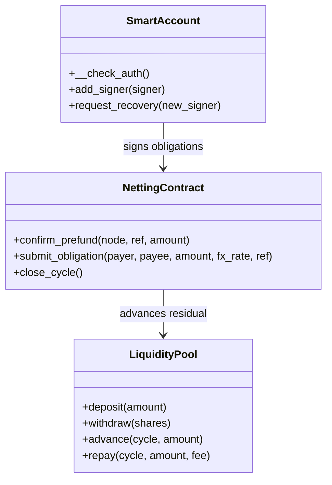

# Rift: Stellar Integration Plan

## 1. Overview

- Rift settles East African trade payments on Stellar.
- Businesses pay in local currency (KES, TZS). Rift nets obligations daily in a Soroban contract.
- Only the residual moves, as USDC on Stellar, to Tanzania or to international suppliers.
- International suppliers = suppliers outside East Africa. We start with China, where most of our businesses' suppliers are.

## 2. Architecture

## 3. End-to-end flow

## 4. Building block integration plan

### 4.1 Anchor Platform

| | |
| --- | --- |
| Role | Kenya and Tanzania nodes for local-currency in and out |
| SEP-1 | `stellar.toml` for each node |
| SEP-10 | Businesses and partner anchors authenticate with Stellar accounts |
| SEP-12 | KYB for each business |
| SEP-38 | Firm quote; locks the FX rate when the obligation is submitted |
| SEP-31 | Receive cross-border payments; pay out KES/TZS via SasaPay and TEMBO |
| Rift builds | Business-server callbacks linking Anchor Platform to SasaPay, TEMBO and the netting contract |
| Done when | A SEP-31 payment from a test sender pays out in KES and TZS |

### 4.2 Bridge

| | |
| --- | --- |
| Role | Pay international suppliers in USD |
| Setup | Each supplier is a Bridge customer with an external bank account and a Stellar deposit address |
| Flow | Pool sends USDC on Stellar to that address; Bridge pays USD to the bank |
| Status | Bridge webhook confirms payout; a failed payout returns USDC to the pool and retries next cycle |
| Done when | A live USDC → USD payout to a supplier |

### 4.3 CCTP

| | |
| --- | --- |
| Role | Bring USDC held on Base (and other chains) onto Stellar, 1:1 |
| Flow | `depositForBurn` on Base with Stellar as destination; native USDC minted on Stellar to the pool |
| Who uses it | Rift treasury, liquidity providers, businesses moving existing Base balances |
| Done when | A Base → Stellar transfer lands in the pool |

### 4.4 Stellar Wallets Kit

| | |
| --- | --- |
| Role | Liquidity provider wallet connection |
| Wallets | Freighter, LOBSTR, xBull and others |
| Flow | LP dashboard signs `deposit` and `withdraw` calls to the pool contract |
| Done when | An LP deposits and withdraws USDC on mainnet |

## 5. Stellar components Rift builds

| Stellar feature | Use |
| --- | --- |
| Soroban (Rust, soroban-sdk) | Netting contract, liquidity pool, smart accounts; all open source |
| USDC Stellar Asset Contract | Every USDC transfer in and out of the pool |
| secp256r1 (CAP-51) | Business passkeys verified on-chain in `__check_auth` |
| Fee-bump (CAP-15) | Rift pays network fees for businesses |
| Sponsored reserves (CAP-33) | Rift sponsors business account reserves |
| Stellar RPC + contract events | Submission, simulation, monitoring |
